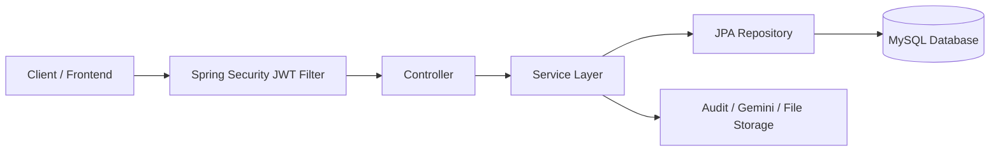

# Exam App Backend - Function Overview and System Design

## 1. Project Purpose

This project is a Java Spring Boot backend for an educational exam platform. It supports:

- user authentication and authorization
- role-based access control (RBAC)
- subject and topic catalog management
- question bank management
- exam creation, scheduling, and submission
- student grouping and targeted exam access
- exam result tracking and reports
- proctoring event monitoring
- AI-based explanation generation using Gemini
- audit logging and upload services

The system is designed for a school or training environment where administrators, teachers, and students interact through a web/mobile frontend connected to this backend API.

---

## 2. Technology Stack

- Java 11
- Spring Boot 2.7.14
- Spring Web + REST API
- Spring Data JPA
- MySQL as the primary database
- Spring Security + JWT
- Hibernate / JPA validation
- Apache POI for Excel import
- Google GenAI SDK (Gemini) for AI explanation
- Lombok for reducing boilerplate
- OpenAPI/Swagger for API documentation
- Docker and Docker Compose support for local deployment

---

## 3. Main Functional Modules

### 3.1 Authentication and Login

The application exposes login and JWT-based session management through:

- /api/auth/login

Responsibilities:

- verify user credentials
- generate JWT token after successful login
- return the user roles to the client
- enforce stateless security using JWT

Default accounts are created at startup by the data initializer:

- admin / admin123
- teacher1 / teacher123
- student1 / student123

These accounts are assigned default roles and permissions.

### 3.2 Role-Based Access Control (RBAC)

The system uses a permission-based security model.

Main concepts:

- Role: ADMIN, TEACHER, STUDENT
- Permission: question:create, exam:view-results, exam:submit, etc.
- UserRole: relationship between a user and one or many roles

Security and authorization support:

- JWT filter validates incoming requests
- @PreAuthorize checks permission before methods run
- custom permission evaluator decides access rights
- protected endpoints can be limited per role or permission

Endpoints include:

- /api/rbac/ping
- /api/rbac/roles
- /api/rbac/permissions
- /api/rbac/roles/{roleId}/permissions

This allows administrators to define which permission each role can use.

### 3.3 User Management

The user system handles account management for all users.

Functions:

- get current user profile
- list all users
- create a user
- update user information
- assign or change roles
- lock/unlock user status
- auto-generate student ID and employee code based on role

Key endpoints:

- GET /api/users
- GET /api/users/me
- POST /api/users
- PUT /api/users/{userId}
- PUT /api/users/{userId}/roles
- PUT /api/users/{userId}/lock
- PUT /api/users/{userId}/unlock

The user service validates uniqueness for:

- username
- email
- student ID
- employee code

### 3.4 Catalog Management (Subjects and Topics)

This module provides classification of exam content.

Functions:

- create subject
- list subjects
- create topic under a subject
- list topics by subject

Endpoints:

- GET /api/subjects
- GET /api/subjects/{subjectId}/topics
- POST /api/subjects
- POST /api/subjects/{subjectId}/topics

This structure allows the system to organize questions by course/subject and topic.

### 3.5 Question Bank Management

This is the core content module for creating and storing exam questions.

Question support includes:

- SINGLE choice
- MULTIPLE choice
- TRUE_FALSE
- FILL_BLANK

Each question includes:

- content
- subject
- topic
- difficulty
- optional image URL
- answer options
- correctness status
- explanations for answers

Question endpoints:

- GET /api/questions
- POST /api/questions
- PUT /api/questions/{questionId}
- DELETE /api/questions/{questionId}
- POST /api/questions/import (Excel upload)

Business rules:

- at least one answer is required
- single-choice questions require exactly one correct answer
- true/false questions require exactly two answers and one correct answer
- fill-in-the-blank questions require one correct answer
- multiple-choice questions require at least two answers and at least one correct option

The import feature uses Apache POI to load questions from an Excel file and store them into the database.

### 3.6 Exam Management

The exam module manages the lifecycle of assessments.

Functions:

- create exam
- update exam
- delete exam
- generate exam automatically from question bank
- assign exam to student groups
- set duration and score rules
- define start and end times
- shuffle questions or answers
- allow answer review after submission
- submit an exam attempt
- get exam questions for a student or teacher
- enforce time-window and attempt limits

Endpoints:

- GET /api/exams
- GET /api/exams/scheduled
- GET /api/exams/{examId}/questions
- POST /api/exams/{examId}/questions
- PUT /api/exams/{examId}/questions/{questionId}
- POST /api/exams
- PUT /api/exams/{examId}
- DELETE /api/exams/{examId}
- POST /api/exams/generate
- POST /api/exams/{examId}/submit

Important behaviors:

- students only see exams that are currently valid and available for their assigned group
- exam attempts are tracked by attempt number
- max attempts are enforced
- expired exams can be auto-submitted by a scheduled background job
- correct answers are hidden from students in normal exam flow unless the teacher allows answer review after submission

### 3.7 Student Groups and Exam Access Control

The system supports grouping students and restricting exams to specific groups.

Functions:

- create group
- edit group
- delete group
- list group members
- add member to group
- remove member from group

Endpoints:

- GET /api/groups
- GET /api/groups/{id}
- POST /api/groups
- PUT /api/groups/{id}
- DELETE /api/groups/{id}
- GET /api/groups/{id}/members
- POST /api/groups/{id}/members
- DELETE /api/groups/{id}/members/{userId}

This improves access control by making an exam visible only to students in the correct class, batch, or department.

### 3.8 Exam Results and Reporting

This module tracks what students submitted, how they scored, and what the teacher can review.

Functions:

- view a student's exam result
- view detailed result and per-question evaluation
- view all results for a student
- view overall exam report with averages and summary statistics
- evaluate whether answers are correct or blank

Endpoints:

- GET /api/results/{examId}
- GET /api/results/{examId}/detail
- GET /api/results/students/{studentId}
- GET /api/results/exams/{examId}/report
- GET /api/results/results/exams/student/{studentId}

The result detail response includes:

- total questions
- correct/wrong/blank counts
- per-question answer status
- selected answer IDs, fill content, and answer explanations

Students can only see their own results unless they have teacher/admin permissions.

### 3.9 Proctoring and Exam Monitoring

The proctoring module records suspicious or abnormal exam events.

Event types include:

- FOCUS_LOST
- CONNECTION_LOST
- SCREENSHOT

Functions:

- create a proctoring event for a student during an exam
- retrieve all events for an exam
- get a summary of the latest event per student
- highlight alert conditions for suspicious activity

Endpoints:

- POST /api/exams/{examId}/proctoring-events
- GET /api/exams/{examId}/proctoring-events
- GET /api/exams/{examId}/proctoring-events/summary

This helps support online exam integrity monitoring.

### 3.10 AI Explanation Service

The AI module integrates with Google Gemini to explain student answers in Vietnamese.

Endpoint:

- POST /api/ai/explain

It takes a question, the correct answer, the student answer, and the subject, then generates an explanation adapted to whether the student was correct or incorrect.

Behavior:

- if the API key is not configured, the service returns an unavailable response
- if the model call fails, the backend gracefully returns no explanation
- for incorrect answers, it explains why the correct answer is right and why the student's response was wrong
- for correct answers, it provides a short reinforcing explanation

This is useful in learning platforms where the student wants instant feedback after trying a question.

### 3.11 File Upload Service

The application supports file uploads for question images and attachments.

Endpoint:

- POST /api/files/upload

Behavior:

- validates non-empty files
- stores them in the configured upload directory
- creates a public URL under /uploads
- makes file access available through static resource mapping

### 3.12 Audit Logging

The project includes an audit trail for key actions such as:

- user creation
- user role changes
- question creation/update/delete
- exam creation/updating/deletion
- exam submission
- permission and RBAC changes

Audit data includes:

- actor user
- action name
- resource type
- resource ID
- result
- reason
- timestamp

This supports compliance, operational tracking, and troubleshooting.

---

## 4. Core Data Model

### 4.1 User Domain

Main entities:

- User
- Role
- Permission
- UserRole

Relationships:

- a user can have many roles
- a role can have many permissions
- role/permission checks drive API access

### 4.2 Academic Domain

Main entities:

- Subject
- Topic
- Question
- Answer

Relationships:

- each question belongs to a subject
- each question may belong to a topic
- each question has multiple answer options
- one answer option can be marked as correct

### 4.3 Exam Domain

Main entities:

- Exam
- ExamQuestion
- ExamResult
- StudentResponse

Relationships:

- an exam contains many questions
- each question in an exam has an order and per-question score
- students can attempt the exam multiple times depending on maxAttempts
- each attempt is recorded in ExamResult
- StudentResponse stores the answer selected by the student for a specific question

### 4.4 Grouping and Proctoring Domain

Main entities:

- StudentGroup
- StudentGroupMember
- ProctoringEvent
- AuditLog

Relationships:

- student groups contain multiple users
- exams can be bound to one or more groups
- proctoring events record suspicious behavior associated with an exam and student
- audit logs track operation history

---

## 5. System Design and Architecture

### 5.1 Layered Architecture

The application follows a standard Spring layered architecture:

1. Controller layer
   - receives HTTP requests
   - validates inputs
   - calls service methods
   - wraps results in a standard ApiResponse

2. Service layer
   - holds business logic
   - checks permissions and validations
   - orchestrates repository calls
   - implements rules such as exam visibility, attempts, scoring, and auditing

3. Repository layer
   - uses Spring Data JPA repositories
   - handles database CRUD and custom queries

4. Entity layer
   - maps to MySQL tables
   - includes JPA annotations and relationships

5. Security layer
   - JWT authentication
   - role and permission checks
   - CSRF disabled and stateless session

### 5.2 Request Flow

### 5.3 Security Model

The application is configured in SecurityConfig with:

- stateless sessions
- JWT filter inserted before UsernamePasswordAuthenticationFilter
- CORS enabled
- public access for login and Swagger endpoints
- all other routes require authentication

Public routes:

- /api/auth/**
- /uploads/**
- /swagger-ui/**
- /swagger-ui.html
- /v3/api-docs/**

### 5.4 Database Design

The persistence layer uses MySQL and JPA with automatic schema updates.

Configuration:

- ddl-auto: update
- timezone: Asia/Ho_Chi_Minh
- datasource configured through environment variables

This allows the project to evolve with new entities while keeping a simple local setup.

### 5.5 Scheduling and Background Tasks

The project enables scheduling via @EnableScheduling. The system includes automatic cleanup of expired exams and submission checks.

Example behavior:

- when the exam end time has passed, a background job auto-submits active attempts
- this prevents students from keeping an exam in progress after the deadline

### 5.6 File and Static Resource Handling

Uploaded files are stored in a local upload directory configured by:

- app.upload.dir

A static resource handler exposes them under:

- /uploads/**

This allows frontend clients to use uploaded images or attachments directly.

### 5.7 API Standardization

All controllers return a consistent response shape using ApiResponse, such as:

- success
- code
- message
- data

This standardizes client handling across all modules.

---

## 6. Example API Areas

The backend is organized around logical domains:

- /api/auth: login and JWT generation
- /api/users: user management
- /api/rbac: role and permission management
- /api/subjects: academic catalog
- /api/questions: question bank
- /api/exams: exam operations
- /api/results: result and report queries
- /api/groups: student grouping
- /api/files: upload management
- /api/ai: AI explanation
- /api/exams/{examId}/proctoring-events: online proctoring

---

## 7. Operational Notes

### Security recommendations

- rotate JWT secret and never expose it in public code
- use environment variables for production secrets
- restrict CORS in production
- enforce HTTPS in production
- ensure DB credentials stay outside source control

### Scalability notes

- the architecture is cleanly modular and can be extended with service-specific modules
- the JPA model can scale as the number of users, exams, and questions grows
- the AI explanation feature can be throttled or cached if needed
- proctoring logs should be retained with a retention policy in production

---

## 8. Summary

This project is a complete backend for an online examination system with:

- authentication and RBAC
- academic content management
- exam creation and scheduling
- student assessment workflows
- result reporting
- proctoring and audit capabilities
- AI-powered learning support
- file upload integration

It is a practical, production-oriented Spring Boot backend designed for educational institutions that need secure and structured assessment management.
